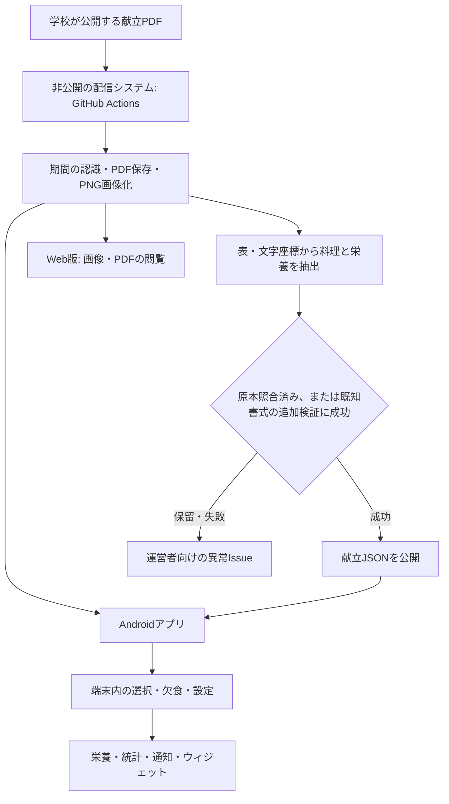

# 寮食アプリ（Nitkc Ryousyoku App）

香川高等専門学校・詫間キャンパスの学生寮の献立を確認する、非公式のAndroidアプリです。画像・PDFに加え、日別の文字表示、栄養レポート、献立統計、通知、ホーム画面ウィジェットを提供します。

- [最新APKをダウンロード](https://github.com/m4sa-k1/nitkc-ryousyoku-app/releases/latest)
- [Web版](https://ryousyoku.m4sak1.me/)：画像・PDFの閲覧
- [利用規約](https://ryousyoku.m4sak1.me/terms.html) / [しくみ](https://ryousyoku.m4sak1.me/about.html)
- 運営者：[m4sak1.me](https://m4sak1.me/) / お問い合わせ：<me@m4sak1.me>

学校・給食業者が提供する公式アプリではありません。献立の変更やアレルギー等については原本・掲示でも確認してください。原本に由来する献立内容・画像・PDFの権利は、学校・給食業者等の権利者に帰属します。

最終更新：2026年11月3日

## 主な機能

| 機能 | 内容 |
| --- | --- |
| 画像・PDF | 今週の献立、過去の一覧、画像の拡大とPDF参照 |
| 文字表示 | 設定から画像表示と切り替え。日付別に朝・昼・夕、A/B、共通料理、案内を表示 |
| 選択・欠食 | 食事ごとにA/Bや欠食を記録。朝食のデフォルトは未設定・ごはん（A）・パン等（B）から選択 |
| 栄養レポート | カロリー・食塩相当量・たんぱく質・脂質の週間推移、内訳、今日までの累計 |
| 献立統計 | 料理・組み合わせの登場ランキング、登場日、月別・曜日別、栄養分布、選択・欠食の内訳 |
| 献立通知 | 朝・昼・夕ごとにオン／オフと通知時刻を設定 |
| 通知アイコン | Kanji Alcohol（酒）を含むMaterial Symbols 28種類から選択。表示中の献立通知も更新 |
| ウィジェット | 次の1食の日付・朝昼夕・献立をホーム画面に表示。リサイズと手動更新に対応 |
| バックアップ | 選択・欠食記録と朝食デフォルトをJSONに保存・復元 |
| 書き出し | 栄養レポートから相談用テキスト／JSONを保存。AIへの自動送信は行わない |
| データ確認 | 公開JSON、表示中の献立の生JSON、端末内の欠食記録を参照 |
| 表示設定 | ダークモード、予測型戻る動作の切り替え |

過去の献立を選ぶと、その回の表示方法を画像・文字から選べます。この操作では設定の既定値を変更しません。

## システム全体の構成



このリポジトリにはAndroidアプリを収録しています。PDF取得・抽出・配信のシステム本体は非公開の別リポジトリで運用しています。以下にその処理とデータの契約を記載するため、非公開リポジトリへのアクセスなしで全体の流れを確認できます。

### 1. PDFの取得・期間認識・画像化

1. GitHub Actionsで毎日0:00（日本時間、UTC 15:00）に更新処理を実行します。手動実行にも対応し、設定された取得休止期間中は公式PDFの取得を休止します。開始時刻はActionsの状況によって遅れる場合があります。
2. [学校の公式PDF](https://www.kagawa-nct.ac.jp/dormitoryE/kondate.pdf)を取得し、SHA-256で前回の内容と比較します。
3. 内容が変わった場合、PDF本文から開始日・終了日を読みます。スラッシュ形式と年月日・曜日付きの形式に対応し、期間を確定できなければ取得日・現在日で補完せず更新を止めます。
4. `YYYYMMDD-YYYYMMDD.pdf` の名前で保存し、先頭ページをPyMuPDFで150 DPIのPNGへ変換します。
5. PDF・画像の一覧を `data/menus.json` に保存します。同じ期間の差し替えは現在版を更新し、変更前の内容はGit履歴に残します。

JSONの抽出は、公式PDFの内容が変わらなかった場合や取得休止中にも、保存済みの全アーカイブに対して実行します。これにより処理の修正や確認待ちの解消も反映できます。

### 2. 料理・選択肢・栄養情報の抽出

Python、PyMuPDF、JSON Schema検証を使う規則ベースの処理です。通常の処理に外部AI APIやOCRは使いません。

- PDFの期間、表の罫線とセル、文字の位置から日付列と朝・昼・夕を特定します。
- 各セルの文字を料理、A/B、共通料理、案内、栄養値に分けます。朝食と夕食のA/Bは食事ごとに独立して扱います。
- 日付・曜日、食事ラベル、文字の割り当てに抜けや重複がないか、料理と栄養欄の選択肢が一致するか、数値・単位に未処理の文字がないか等を検証します。
- 表の外の文字も確認し、既知の注意書き以外に未分類の文字が残る場合は公開を止めます。
- カロリー・たんぱく質・脂質・食塩相当量を保存します。原本にない栄養素やアレルゲンは推定しません。
- 栄養は「選択料理＋共通料理」の1食全体の値です。共通料理の栄養を別に足しません。原本の1日合計も別項目として保持します。
- 空欄を「提供なし」や0栄養と決め付けず、献立あり・記載なし・提供なしを区別します。

文字層から料理を取得できない過去の一部PDFは、原本と照合した転記データで補完しています。この補完はPDF全体のSHA-256が一致する場合だけ使用し、似た書式や同じ期間の別PDFには流用しません。

### 3. 自動公開と保留の判定

公開には、次のどちらかを満たす必要があります。

| 経路 | 公開条件 |
| --- | --- |
| 原本照合済み | PDFのSHA-256と、抽出結果の正規化後SHA-256が、照合済みの固定参照に一致する |
| 新しい文字抽出PDF | 上記の構造検証に加え、確認済み書式・栄養合計・案内表現等の追加検証に成功する |

新しいPDFの追加検証では、ページ寸法・フォント・セル結合・各セルの位置を、確認済み7書式のプロファイルと照合します。座標の許容差はページ寸法の1.5%、ページ寸法自体は1 ptです。描画要素が64個を超える原本も保留し、文字のアウトライン化などを検出対象にします。

原本の1日合計と食事別の栄養を照合し、確認可能なA/Bの対応で、カロリーは2 kcal以内、各g値は0.2 g以内の差を許容します。新しいPDFで合計が一致しない、料理欄に案内と思われる表現がある、書式が一致しない等の場合は保留します。既知書式で検証に通れば、新しい週でも毎回の手動承認は不要です。

| 公開状態 | 意味とアプリの扱い |
| --- | --- |
| `ready` | 構造化データを公開。アプリは原本識別子等を照合して利用 |
| `pending_review` | 抽出できたが自動公開の条件を満たさず保留。文字・栄養表示は利用しない |
| `review_mismatch` | 照合済み原本からの結果が固定参照と異なる。公開を保留 |
| `unavailable` | 抽出や構造検証に失敗。文字・栄養表示は利用しない |

保留・失敗の週は、以前のJSONを現在版として残しません。他の週と、通常のPDF・画像の更新は継続します。抽出候補・診断を保存した後、確認が必要な実行は失敗として報告します。

2026年11月3日時点の固定参照は、履歴から確認した8種類のPDF、54日・162食枠（献立あり160食、記載なし2食）です。自動公開した結果を正解データや既知書式へ自動登録する処理はありません。既知書式の検証は、今後のあらゆる文章や画像の意味まで正確に判別する保証ではありません。

### 4. 異常通知と解決後の反映

異常は配信システム側の非公開リポジトリで、運営者向けのGitHub Issueにまとめます。

- 週別のIssueに期間・理由・PDF識別子・原本・実行ログ・診断成果物へのリンクを記載します。
- 取得・環境準備・診断保存・commit/push等の失敗は、更新処理用のIssueにまとめます。
- 同じ内容の異常では新しいIssueやコメントを作らず、原因やPDFが変化した場合は既存Issueを更新します。
- 検証と公開が正常になった週は自動で閉じ、再発時は同じIssueを再開します。結果不明や公開失敗を理由に、既存の週別Issueを解決扱いにしません。
- 運営者が対応後に対象Issueを閉じると、取得・抽出・検証・公開を再実行します。閉じる操作は承認や検証免除ではなく、異常が残っていれば再開します。
- 本機能のマーカーを持つbot作成Issueだけを管理し、無関係なIssueやPull Requestは変更しません。

診断成果物の保存期間は30日です。メール等の受信方法はGitHubの通知設定に従います。通知API自体の障害、チェックアウト失敗や実行キャンセル等では専用Issueを作れない場合があるため、Actionsの失敗通知も利用します。

AI APIの利用料金は発生しませんが、GitHub Actionsの実行時間・保存容量・配信の利用枠は別に消費します。

## 公開データとアプリ側の検証

配信元は `https://ryousyoku.m4sak1.me/` です。

| パス | 内容 |
| --- | --- |
| `data/menus.json` | PDFファイル名・期間ラベル等の一覧 |
| `files/YYYYMMDD-YYYYMMDD.pdf` | 原本PDF |
| `images/YYYYMMDD-YYYYMMDD.png` | 献立画像 |
| `data/parsed/index.json` | 構造化データの公開状態、原本SHA-256、週別JSONへの相対パス |
| `data/parsed/YYYYMMDD-YYYYMMDD.json` | 日付・食事・料理・選択肢・栄養情報 |
| `data/skip_periods.json` | 配信側のPDF取得休止期間。利用者の欠食記録とは別 |

構造化データは `schema_version: 1`、日付は `YYYY-MM-DD`、タイムゾーンは `Asia/Tokyo` です。各食の `options[].nutrition` に共通料理込みの栄養を保持します。

アプリは `ready` のデータだけを読み、一覧と本文のファイル名・SHA-256、期間、日付の連続性、朝昼夕、選択肢、栄養値の型・範囲を照合します。原本改訂時は旧キャッシュを新しい原本の結果として扱いません。通信失敗時に検証済みの保存データを使う場合は、その状態を表示します。

トップの初期表示は、一覧のファイル名から読み取った期間と端末の現在日時で選びます。該当期間がなければ一覧の先頭を使います。これは起動・再取得時の選択で、トップ画面が常駐タイマーによって月曜0時ちょうどに切り替わる仕組みではありません。文字表示の日付や各種集計・通知・ウィジェットは日本時間を基準とします。

## 集計と個人記録のルール

### 選択・栄養・書き出し

日別の明示的なA/B選択・欠食を優先し、朝食のデフォルトは明示的な記録がない場合に反映します。パン等（B）にはホットケーキ等のB献立も含みます。選択肢がない食事は固定献立として扱います。

- 栄養は献立に基づく予定量で、実際の摂取量を測定したものではありません。
- 明示的な欠食だけを0として扱い、未選択・未取得・記載なし・不明値は0と区別します。集計済み食数を併記します。
- 週間は「選択内容」「Aで試算」「Bで試算」を分けます。累計は日本時間の今日までです。
- 書き出しは原本識別子、料理、選択・欠食、栄養、未取得・不明値を含みます。未来の献立も区別して含むため、累計の範囲と書き出し全体の範囲は異なります。
- 相談用テキスト／JSONを保存するだけではAIへ送信されません。

### 献立統計

全期間・直近30日・直近7日と、全食・朝・昼・夕で絞り込みます。未来は除き、未取得の範囲や保存データを区別します。

料理は全角・半角と空白だけを正規化し、料理名ごとに同じ1食内のA/B・共通料理の重複を除きます。献立の組み合わせは「選択料理＋共通料理」のセットで、順序を無視し、同じ1食内の同一セットを重複させません。掲載回数に未選択の候補も含め、個人の選択・欠食で料理ランキングを変えません。

栄養分布はA/Bをそれぞれ1候補として平均・最大・最小を計算します。選択等を反映した個人の予定量は別に集計します。登場回数を、実際に食べた回数や人気と解釈しないでください。

### バックアップ

記録のキーは「原本SHA-256／日付／食事区分」です。原本が改訂された場合、旧版の選択を新しい原本へ自動で引き継ぎません。

バックアップ形式は `nitkc-ryousyoku-personal-backup` のversion 1です。選択・欠食と朝食デフォルトを含み、2 MiB・10,000記録まで検証します。読み込み後は件数等を確認し、追加・統合（同一キーはバックアップ優先）か全置き換えを選べます。キャンセルや検証失敗では現在の記録を変更しません。

献立本体、キャッシュ、テーマ・表示設定、通知の時刻・アイコン設定はバックアップ対象外です。復元用バックアップと、栄養の相談用書き出しは別形式です。個人記録を運営者へ送信・同期する機能はありません。

## 献立通知

設定から朝・昼・夕ごとに通知のオン／オフと時刻を保存します。初期状態はすべてオフ、初期時刻は7:00／12:00／18:00で、日本時間の毎日を対象とします。

- 朝食のデフォルトがある場合は、そのA/Bの料理と共通料理を表示します。未設定なら両方、固定献立ならその献立を表示します。
- 昼夕は選択肢をすべて表示します。日別のA/Bや欠食記録によって通知を自動停止・変更する機能はありません。
- Android 13以降では通知許可が必要です。Android 12以降で正確なアラームが許可されていなければ、時刻を目安に予約します。
- AlarmManagerからWorkManagerへ処理を渡し、当日の献立を取得して通知します。省電力・実行制限・通信状況により遅れる場合があります。
- 再起動・アプリ更新・時計変更・許可付与・アプリ復帰時に予約を設定し直します。変更前の設定や当日以外の遅延通知は送らず、通常通知は同じ日・食事で重複させません。
- Kanji Alcohol（酒）を含むMaterial Symbols 28種類を同梱し、選択を保存します。変更時は既存の献立通知も、本文を変えず、音を鳴らし直さずに更新します。

## 次の献立ウィジェット

設定の「ホーム画面ウィジェット」から追加できます。ランチャーが対応していない場合は、ホーム画面の長押し→ウィジェットから「次の献立」を選びます。

日付・朝昼夕・料理を角丸のカードに表示します。時間帯自体は表示しません。縦横リサイズ対応で、小さいときは省スペース表示になります。タップで対象日の献立を開き、更新ボタンから再取得できます。

| 内部判定に使う食事の目安 | 表示対象の切り替え |
| --- | --- |
| 朝食 7:30～8:30 | 8:30に昼食へ |
| 昼食 11:50～12:50 | 12:50に夕食へ |
| 夕食 18:00～20:00 | 20:00に翌日の朝食へ |

開始前は次の食事、食事中はその食事を表示します。日別のA/B・欠食が優先され、朝食のデフォルトも反映します。未選択のA/Bは分け、共通料理は1回だけ表示します。データのない日に別の日の献立を出すことはありません。

AppWidgetProvider／RemoteViewsを使い、置かれている場合だけ30分ごとのWorkManager更新、切り替え時刻のアラーム、手動更新、設定・記録変更等で更新します。キャッシュ利用は明記し、配信保留等を確認したデータは旧キャッシュから復活させません。最後のウィジェットを削除すると予約と定期処理を解除します。OSの制限により切り替えが遅れる場合があります。

## 開発環境・ビルド

Android 8.0（API 26）以降。JDK 17とAndroid SDK 34を使用します。Kotlin、Jetpack Compose、Material 3、OkHttp、kotlinx.serialization、Coil、WorkManagerで構成し、ウィジェットはネイティブのRemoteViewsです。

```sh
./gradlew assembleDebug
./gradlew testDebugUnitTest
./gradlew assembleRelease
```

Windowsでは `gradlew.bat` を使用します。SDKの場所はローカルの `local.properties` に指定します。

| ビルド | Application ID | 取得先 |
| --- | --- | --- |
| release | `com.m4sak1.ryousyoku` | 常に本番ドメイン |
| debug | `com.m4sak1.ryousyoku.debug` | 既定は本番。`-PmenuBaseUrl=...` で上書き可能 |

```sh
./gradlew assembleDebug assembleDebugAndroidTest -PmenuBaseUrl=http://127.0.0.1:8765/
adb -s <確認端末> reverse tcp:8765 tcp:8765
```

`-PpreviewBuildDir=<絶対パス>` でアプリモジュールの出力先を変更できます。通常版とdebug版は別パッケージです。ローカル配信やテスト用の8週分のJSONを製品APKの献立データとして同梱することはありません。

ローカルreleaseビルドは、署名鍵の設定がなければdebug署名を使用します。公開APKの署名はCIの設定に従います。コード・保存モデル・テストの詳細は [docs/structured-menu.md](docs/structured-menu.md)、更新履歴は [CHANGELOG](app/src/main/assets/CHANGELOG.md) を参照してください。

## 自動リリースと文書更新

[release.yml](.github/workflows/release.yml) は `main`／`dev` へのpushで起動します。`main` はパッチ版を更新して正式リリース、`dev` はbetaカウンターを更新してプレリリースを作成します。`version.properties` のbuildカウンターも更新し、署名設定に従ってAPKをGitHub Releasesへ公開します。

文書だけを更新し、そのpushでリリースを作成しない場合は、コミットメッセージに `[skip ci]` を付けます。これは [GitHub標準のスキップ指定](https://docs.github.com/en/actions/how-tos/manage-workflow-runs/skip-workflow-runs) で、該当コミットの `push`／`pull_request` 起動だけを回避します。ワークフローを恒久的に無効化する設定ではありません。

## ライセンスと行動規範

アプリのコードは [PolyForm Noncommercial License 1.0.0](LICENSE) で公開しています。許可される利用目的や再配布時の条件は本文を確認してください。献立データの権利とは別です。

同梱するMaterial SymbolsはGoogleのApache-2.0ライセンスです。[出典・変更内容](app/src/main/assets/licenses/material-symbols/NOTICE.txt) と [ライセンス本文](app/src/main/assets/licenses/material-symbols/LICENSE) を収録しています。その他の依存ライブラリはアプリ内のオープンソースライセンス画面から参照できます。

参加にあたっては [行動規範](CODE_OF_CONDUCT.md) を確認してください。
